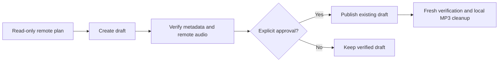

# Publish a sermon to WordPress

## Safety rules

- Use committed CLI commands; no ad-hoc publishing scripts.
- Never print credentials or repair unrelated historical posts.
- Confirm metadata and require explicit publication approval; Planning Center/QC values alone establish neither.
- Present read-only plan before remote mutation.
- Keep receipts and runtime artifacts in gitignored `.sermon-qc/`; never overwrite receipts.



## 1. Plan — read-only remotely

Obtain processed MP3, matching QC, and confirmed metadata:

```sh
pnpm publication plan <sermon.mp3> \
  --qc .sermon-qc/<sermon.mp3>.qc.json \
  --receipt .sermon-qc/<sermon.mp3>.publication.json \
  --preacher "<preacher>" --series "<series>" --date <yyyy-mm-dd> \
  --scripture "<reference>" --title "<title>"
```

| Precondition         | Rule                                                                                              |
| -------------------- | ------------------------------------------------------------------------------------------------- |
| Speaker and Series   | Existing WordPress terms required; never guess ambiguous matches.                                 |
| Series artwork       | Reuse matched Series image; add `--artwork <local.jpg-or-png>` for first sermon without an image. |
| Site timezone        | Must be `America/New_York`.                                                                       |
| Duplicate protection | Refuse duplicate dates, including trash, and possible orphan audio attachments.                   |
| Receipt              | New local file pins input/QC/artwork bytes and site configuration; no remote mutation.            |

**Present before mutation:**

- Title and scripture.
- Preacher and matched speaker.
- Series and artwork ID.
- Exact date at noon Eastern.
- Media host and intended draft status.

## 2. Draft and verify

```sh
pnpm publication draft <receipt.json>
pnpm publication verify <receipt.json>
```

- Draft journals mutation intent and results.
- Verify metadata, Series artwork, audio association, and HTTPS media host.
- Verify full remote audio SHA-256 and HTTP 404 for equivalent local upload path.
- Provide edit link: `<WORDPRESS_URL>/wp-admin/post.php?post=<post-id>&action=edit`.

## 3. Publish — explicit approval required

```sh
pnpm publication publish <receipt.json> --approve
```

- Updates existing verified draft to published status and `<yyyy-mm-dd>T12:00:00`.
- Never uploads another MP3; retries verify existing publication instead of creating duplicates.
- Verify public page/title and remote audio before declaring success.

## 4. Clean up verified local output

```sh
pnpm publication cleanup <receipt.json>
```

- Routine post-publication cleanup is permitted.
- Command freshly verifies public post, remote bytes, and matching local bytes before deletion.
- Remove **only** matching local processed MP3.
- Never delete source AIFF/WAV, artwork, QC, receipt, or diagnostics.
- Verification and repeated cleanup remain available after MP3 removal.

## Interrupted or failed operations

**Stop before another upload. Explain failure and intended fix before changing code.**

```sh
pnpm publication reconcile <receipt.json>
# After inspection and explicit selection of intended post:
pnpm publication reconcile <receipt.json> --post-id <id>
pnpm publication verify <receipt.json>
```

| Situation                        | Action                                                                                                                 |
| -------------------------------- | ---------------------------------------------------------------------------------------------------------------------- |
| Uncertain remote result          | Reconcile with remote `GET` requests only. Adopt only explicitly selected, fully verified post.                        |
| Incomplete upload / orphan media | Inspect journal and attachments. Operator decides whether to finish or remove leftovers; no automatic orphan deletion. |
| Receipt lock directory           | Verify no owning process is running before removing stale `.lock` directory.                                           |
| Local audio                      | Keep until publication is verified.                                                                                    |

Never change transport, delete receipt, create a new plan, or blindly retry upload
to bypass an error.
