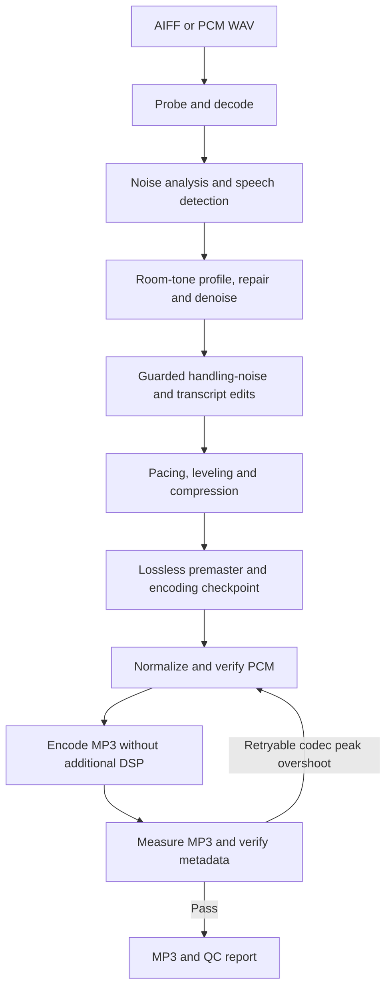

# Processing pipeline

Source recordings stay unchanged. All intermediate audio is lossless PCM; only
final delivery uses lossy MP3 encoding.



## Preparation stages

| Stage                     | Processing and safety checks                                                                                                                                                                                        |
| ------------------------- | ------------------------------------------------------------------------------------------------------------------------------------------------------------------------------------------------------------------- |
| Probe and decode          | Validate AIFF or PCM WAV; decode first audio stream to mono 48 kHz 24-bit PCM.                                                                                                                                      |
| Analyze                   | Find low-level intervals with `silencedetect`; measure up to five longest with `astats`; derive bounded thresholds. Detect speech with local Silero VAD.                                                            |
| Repair and denoise        | Select verified speech-free room tone; capture 15-band noise profile. Apply high-pass, `adeclick`, and `afftdn`; remeasure noise floor. Report adaptive-denoising fallback when no verified profile is available.   |
| Handling-noise edits      | Detect 0.4–1.5 second broadband bursts with `astats`/`aspectralstats`. Remove only with quiet boundaries, no speech, and confidence at least 0.86 by default. Apply short equal-power crossfades; report ambiguity. |
| Optional transcript edits | Combine Whisper confidence and Silero VAD. Shorten eligible 2–30 second non-speech gaps. Retain/report low-confidence words, speech overlap, and longer gaps.                                                       |
| Premaster                 | Trim leading silence; shorten qualifying pauses to 400 ms. Apply `dynaudnorm` and moderate compression. Save lossless premaster and fingerprinted encoding checkpoint.                                              |

## Normalization and delivery

| Default                              | Value                                                                    |
| ------------------------------------ | ------------------------------------------------------------------------ |
| Loudness target / accepted tolerance | −16 LUFS / ±2 LU                                                         |
| Loudness-range target                | 7 LU                                                                     |
| Final MP3 true-peak ceiling          | −1.5 dBTP; no extra tolerance                                            |
| Initial codec headroom               | 2.8 dB below final ceiling: PCM target −4.3 dBTP                         |
| PCM true-peak verification tolerance | 0.6 dB above PCM target; not extra budget for PCM-undershoot linear gain |
| Delivery format                      | Mono 44.1 kHz, 64 kbps MP3, ID3v2.3 tags and embedded artwork            |

1. Measure premaster; apply two-pass `loudnorm`, sample-peak limiting, and resampling.
2. Independently measure normalized PCM; recover undershoot only through verified processing below.
3. Encode MP3 **without additional DSP**; measure encoded loudness and peak separately.
4. Verify codec, bitrate, channels, metadata, and artwork before delivering output.

### Automatic recovery

| Condition                                                  | Response                                                                                                                                                                           |
| ---------------------------------------------------------- | ---------------------------------------------------------------------------------------------------------------------------------------------------------------------------------- |
| PCM below floor, enough peak margin                        | Apply bounded linear gain; remeasure before promotion/encoding.                                                                                                                    |
| PCM below floor, insufficient linear-gain margin           | Use measured dynamic FFmpeg normalization to reshape peaks; remeasure before promotion/encoding.                                                                                   |
| MP3 below floor, both PCM and MP3 peak margins permit gain | Apply calibrated gain to PCM; verify PCM, re-encode, and remeasure MP3.                                                                                                            |
| MP3 peak overshoot                                         | Retry from premaster with measured additional headroom. Gain-corrected encodes may warrant fresh normalization even when simple attenuation predicts insufficient loudness margin. |
| Recovery cannot pass QC                                    | Fail and preserve diagnostics. Never weaken delivery targets.                                                                                                                      |

- Headroom retries are bounded to three normalization attempts.
- QC records actual encode count, timings, final measurements, corrections, and warnings.
- Report-only regions remain unchanged. Automatic QC does not claim a listening review.

## Resume after failure

```sh
pnpm resume <work-directory>/encoding-checkpoint.json
```

- Verifies source, artwork, and premaster SHA-256.
- Retains edit audit and preparation timings; no decoding, denoising, VAD, or transcription repeats.
- Never overwrites an existing MP3.
- Failures before checkpoint creation need diagnosis; older runs without checkpoints cannot resume automatically.

| Diagnostic file                            | Stage                                                               |
| ------------------------------------------ | ------------------------------------------------------------------- |
| `04-transcript-clean.wav`                  | Transcript-gap edits                                                |
| `05-premaster.wav`                         | Pacing, leveling, compression; resume input                         |
| `06-normalized.wav`                        | Normalized PCM before codec-loss correction                         |
| `06-corrected.wav` / `06-renormalized.wav` | Recovery files; promoted after verification, so may no longer exist |
| `08-corrected.wav`                         | PCM after codec-loss gain correction, when needed                   |
| `07-output.mp3`                            | Encoded MP3, when encoding completed                                |

## QC review

- Read `.sermon-qc/<output-filename>.qc.json`; retain it with the publication receipt.
- Compare size with `durationSeconds × 8,000` bytes plus metadata/container overhead.
- Review every removed/reported handling event and shortened/reported transcript gap.
- Include room-tone interval, pre/post noise floors, analysis/pause thresholds, tool versions, and warnings.
- See [processing skill](../.agents/skills/process-sermon/SKILL.md) for the full reporting checklist.

## Detector limitations

- Favor missed noise over damaged speech: fricatives and plosives can resemble static.
- Retain candidates without quiet boundaries or with Silero-detected speech.
- Listen around ambiguous timestamps before proposing lower confidence thresholds.
- Evaluate representative private recordings before making thresholds more aggressive or introducing an AudioSet classifier.
